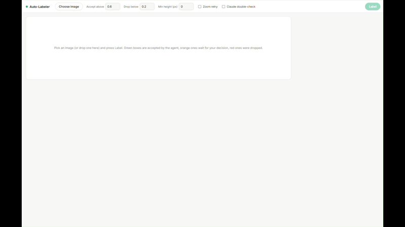
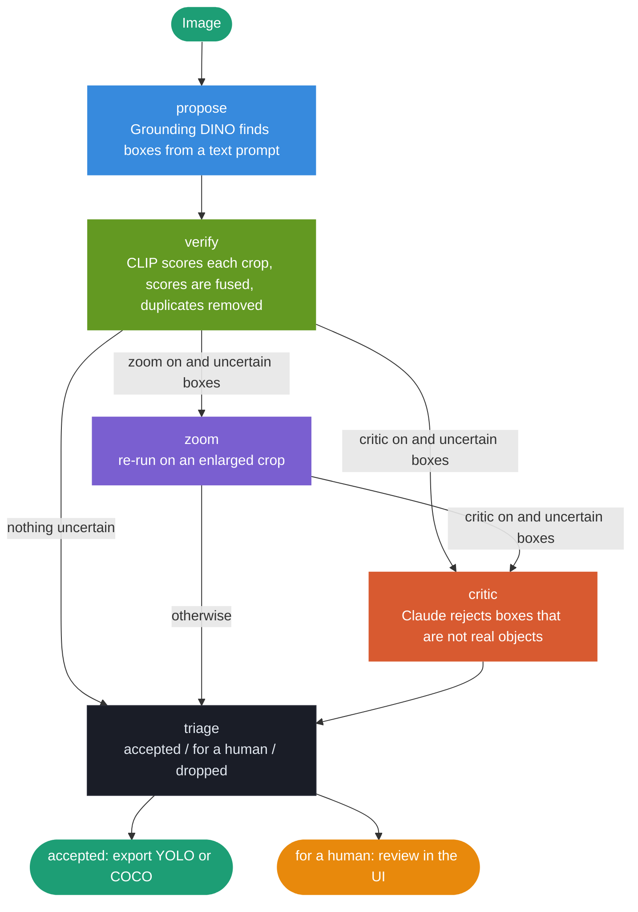

# Auto-Labeler

> An agent that labels street images with bounding boxes and asks a human only about the boxes it is unsure of.

<div align="center">


<br/>



<br/>

**Drop in a street photo and get labelled boxes back.**  
Grounding DINO proposes boxes, CLIP scores them, and an optional Claude step rejects fake ones.  
Confident boxes are accepted, doubtful ones wait for a human, and the rest are dropped.

</div>

---

## Pipeline



---

## The two models

The agent combines two models that are good at different things.

| | Grounding DINO | CLIP |
|---|---|---|
| What it is | An open-vocabulary detector: given a text prompt (`car. person. bicycle.`) it finds matching boxes in any image, without being trained on KITTI | An image-text matching model: given a crop and a list of sentences, it says how well each sentence describes the crop |
| Question it answers | "Where are things that look like these words?" | "What is in this crop?" |
| Output | Boxes, each with a score for how well it matches the words | A probability over 8 descriptions: car, pedestrian, cyclist, and five non-objects (road, building, trees, pole or sign, empty background) |
| Strength | Finds and localises objects | Judges whether a given crop is really that class or just background |
| Weakness | Its score is not calibrated, and it can be fooled by lookalikes such as a billboard | It cannot find boxes, only judge boxes someone else proposes |

**Why fuse them.** DINO proposes, CLIP double-checks. Each box gets a confidence of `0.7 × DINO score + 0.3 × CLIP score`, so a box ranks highest when the detector and the crop-level judge both agree. In my tests the gain in accuracy was small (mean AP 72.3 without CLIP, 72.9 with it, which is within noise), so the fusion is not what makes the agent accurate. What it gives is a second opinion on every box from a model that looks only at the crop, and CLIP's score is also what the zoom step uses to re-score a box.

**Why 0.7 and 0.3.** DINO gets the larger weight because it sees the whole image and does the localising, while CLIP only sees a crop shrunk to 224 × 224 pixels. KITTI pedestrians are often around 30 × 80 px, so CLIP gets blurry crops of them and is unreliable there: a rule that dropped every box with a CLIP score below 0.1 lowered pedestrian AP from 64.9 to 58.5, which means many real pedestrians get a low CLIP score. So CLIP is a supporting vote, not an equal one. The exact split is a judgement call, not a tuned value. I compared six ways of combining the two scores on 200 training images (moderate AP, mean over the three classes) and kept the weighted sum, the only one that did not lose accuracy:

| How the two scores are combined | Mean AP |
|---|---|
| DINO only | 72.3 |
| **0.7 × DINO + 0.3 × CLIP (used)** | **72.9** |
| Average of the two (0.5 / 0.5) | 71.3 |
| Geometric mean | 68.9 |
| The lower of the two | 67.6 |
| DINO, dropping boxes with CLIP below 0.1 | 67.6 |

I did not search other weights such as 0.6 / 0.4 or 0.8 / 0.2, because differences of a few tenths of AP on 200 images are noise.

---

## Results

The agent was run on **100 KITTI validation images**. KITTI's ground truth played the human reviewer: it approves a queued box only if the box matches a real KITTI object. Settings: accept at 0.60 or above, drop below 0.20, KITTI-style AP (moderate difficulty).

| | Auto-accepted boxes | Auto precision | Boxes a human checks per image | AP after human review | Claude cost (100 images) |
|---|---|---|---|---|---|
| Agent without Claude | 236 | 81% | 6.0 | 76.1 | – |
| Agent with Claude | 236 | 81% | **3.5** | 68.7 | $0.53 |

**What the columns mean**

- **Auto-accepted boxes** are the boxes above the accept threshold, summed over the 100 images.
- **Auto precision** is the share of those boxes that match a real KITTI object (IoU of at least 0.7 for cars, 0.5 for pedestrians and cyclists). 81% means about four in five.
- **Boxes a human checks per image** is the size of the review list: the uncertain boxes left after the agent's own steps.
- **AP after human review** is the KITTI-style average precision of the final label set: the auto-accepted boxes plus the queued boxes the simulated reviewer approved, averaged over car, pedestrian and cyclist. It is not the same as precision. Precision asks only "of the boxes I labelled, how many are right?". AP also asks "how many of the real objects did I find?". A label set where every box is correct but half the objects are missing has high precision and a low AP. That is why AP is the better summary of the final dataset, and why it stays below 100: objects that nobody proposed are missing.

**What the numbers show**

- Claude was asked about 605 uncertain boxes and rejected 260 of them. 252 of those rejections (97%) were boxes that are really not in KITTI.
- That removes **42% of the human review work** for about half a cent per image.
- The price is accuracy: the 8 rejected boxes that did match a KITTI object are gone for good, and that is what lowers the AP after review from 76.1 to 68.7. Whether that trade is worth it depends on what a human check costs you.
- Claude's **YES** answers were not reliable enough to accept boxes on their own (in a 20-image test only 56% matched KITTI), so it can only reject boxes, never accept them.

### Limitations

- Only three classes: car, pedestrian, cyclist.
- One run on 100 images, with no confidence intervals. Thresholds were chosen on 200 training images.
- The simulated reviewer is strict. A real object that KITTI did not annotate (often a distant one) counts as wrong, so true precision is probably higher than reported.
- Objects the proposer never finds cannot be recovered by anything after it.
- I did not inspect the 8 real objects Claude rejected. Tiny, blurry crops are the likely cause, since Claude often answers "too blurry to confirm" for them.

---

## Orchestration concepts

| Concept | Where it appears |
|---|---|
| Multi-agent pipeline | Proposer (DINO), verifier (CLIP), critic (Claude vision) and a triage policy, each its own module |
| Shared state | `State` TypedDict flows through every node; each node returns only what it changes |
| Rule-based router | A router is a small function that picks the next step. Here it is plain `if` logic (is the step switched on? is there an uncertain box?), not a language model. A model could make that choice, but rules are free, instant and predictable |
| Conditional branching | Zoom and critic are skipped when no box is uncertain or the step is switched off |
| Claude as a veto | Claude can lower a box to zero but never raises one, because its YES answers were unreliable |
| Human-in-the-loop | Doubtful boxes go to a review list in the UI; approved boxes join the final labels |
| Simulated reviewer | `experiment.py` uses KITTI ground truth as the human to measure work saved and accuracy |
| Cost control | Dry run shows the Claude call count and cost before spending; answers are cached by hash of crop, class, model and prompt |
| Several front doors | The same agent runs from the command line, a FastAPI server, a React UI and an MCP server |

---

## Project structure

```
kitti-autolabel/
│
├── backend/                         Python: the agent, API and MCP server
│   │
│   ├── agents/
│   │   ├── proposer.py              Grounding DINO: boxes from the prompt "car. person. bicycle."
│   │   ├── verifier.py              CLIP: scores a crop against class and non-class descriptions
│   │   └── critic.py                Claude vision: is this crop a real object? (YES / NO + reason)
│   │
│   ├── graph/
│   │   ├── state.py                 State and Settings: the data contract between nodes
│   │   ├── pipeline.py              LangGraph StateGraph: nodes, routers, edges
│   │   ├── policy.py                Triage: accepted, for a human, dropped
│   │   └── retry.py                 Zoom retry on an enlarged crop
│   │
│   ├── tools/
│   │   ├── types.py                 Box, Detection, GTObject
│   │   ├── boxes.py                 IoU, NMS, crop expansion
│   │   ├── cyclists.py              Merges person + bicycle into a cyclist box
│   │   ├── scoring.py               Fuses DINO and CLIP scores
│   │   ├── kitti.py                 KITTI loader and train/val split
│   │   ├── evaluate.py              KITTI-style AP (40 recall points)
│   │   ├── simulate.py              Simulated human reviewer
│   │   ├── export.py                YOLO text files and COCO json
│   │   └── visualize.py             Draws decisions on an image
│   │
│   ├── tracing/
│   │   └── logger.py                Per-image decision record
│   │
│   ├── tests/                       pytest suite (fake models, no GPU or API key needed)
│   ├── main.py                      Command line: label images, export labels
│   ├── api.py                       FastAPI server
│   ├── mcp_server.py                MCP server: use the labeler from Claude
│   ├── experiment.py                The results table above
│   ├── requirements.txt
│   └── .env                         ANTHROPIC_API_KEY (never committed)
│
└── frontend/                        React: Vite
    ├── src/
    │   ├── App.jsx                  The whole UI
    │   ├── index.css                Styles
    │   └── main.jsx                 Entry point
    ├── vite.config.js               Vite config + API proxy to port 8000
    └── package.json
```

---

## Shared state

A single `State` TypedDict flows through every node. Each node returns only the keys it changes, and LangGraph merges them. The `trace` list uses a reducer, so each node's lines are appended instead of replaced.

```python
@dataclass(frozen=True)
class Settings:
    accept_above: float = 0.60   # confidence at or above this: accepted automatically
    drop_below: float = 0.20     # confidence below this: discarded
    min_height: float = 0.0      # boxes shorter than this (pixels) are discarded
    zoom: bool = False           # look again, from closer, at uncertain boxes


class State(TypedDict, total=False):
    name: str                                  # image name, for messages
    image: Image.Image
    boxes: list[Detection]                     # current boxes, updated by every node
    accepted: list[Detection]                  # final: kept automatically
    for_human: list[Detection]                 # final: waiting for a human
    dropped: list[Detection]                   # final: discarded
    api_cost: float                            # dollars spent on Claude for this image
    trace: Annotated[list[str], operator.add]  # what each agent did, in order
```

---

## LangGraph graph

```python
graph = StateGraph(State)

graph.add_node("propose", propose)
graph.add_node("verify",  verify)
graph.add_node("zoom",    zoom)
graph.add_node("critic",  ask_claude)
graph.add_node("triage",  decide)

graph.add_edge(START, "propose")
graph.add_edge("propose", "verify")

# routers: plain rules, no model involved
graph.add_conditional_edges("verify", after_verify, {"zoom": "zoom", "critic": "critic", "triage": "triage"})
graph.add_conditional_edges("zoom",   after_zoom,   {"critic": "critic", "triage": "triage"})

graph.add_edge("critic", "triage")
graph.add_edge("triage", END)
```

---

## How a box is decided

Confidence is `0.7 × DINO score + 0.3 × CLIP score`.

| Confidence | Result |
|---|---|
| At or above `accept_above` (0.60) | Accepted automatically |
| Between `drop_below` (0.20) and `accept_above` | **Uncertain**: zoom retry and the Claude step apply, and what is left goes to a human |
| Below `drop_below`, or shorter than `min_height` | Dropped |
| Rejected by Claude | Score set to 0, so dropped |

Person + bicycle detections are merged into a single **Cyclist** box. Duplicates are removed per class with non-maximum suppression.

### The Claude step (critic)

**Why it exists.** DINO and CLIP only compare pixels with words, so they can be fooled by things that look like an object but are not: a pedestrian printed on a billboard, a reflection, a blurry blob. A vision-language model understands the scene, so it can tell a poster from a person. It is also the one step that costs money, so it only sees the boxes the agent is unsure about, never the confident ones.

**What it receives.** One uncertain box at a time: a crop of that box (with a small margin, enlarged so the short side is at least 256 px) and this question, shown here for a car. For the other classes the word is replaced by *pedestrian* or *cyclist riding a bicycle*:

> This is a crop from a photo taken by a camera on a car. Is the main object a real car in the scene, and not a picture, poster, reflection or drawing of one? Answer YES or NO, then one short reason (at most 15 words).

**What happens next.**

| Claude answers | Result |
|---|---|
| NO | The box is dropped (its score is set to 0). The reason is kept in the trace |
| YES | Nothing changes. The box stays in the human review list |
| Anything else | Nothing changes |

**Why it can only reject.** In a 20-image test, Claude's YES answers matched a KITTI object only 56% of the time (many were real but unannotated distant objects), so letting a YES accept a box would put unchecked labels into the dataset. Its NO answers were right 97% of the time on 100 images, so rejection is the part to trust.

**Example.** On KITTI image `000010`, two pedestrians (confidence 0.47 and 0.33) are really people printed on a billboard. Claude rejects both:

```
critic: rejected Pedestrian (conf 0.47): It's a printed poster with a website URL at the bottom, stylized monochrome image, flat.
critic: rejected Pedestrian (conf 0.33): It's a printed poster or billboard, showing street text and a flat stylized image.
```

It also rejects tiny blurry crops ("too blurry to confirm a real car"), which is why it removes so many boxes, and why some of what it removes can be real.

**Cost and settings.** The default model is `claude-sonnet-5-5`, about $0.001 per box, which came to about half a cent per image in the experiment. Thinking is switched off because a yes/no judgement does not need it. Every answer is cached on disk, so repeating the same image costs nothing.

---

## Setup

### Prerequisites

- Python 3.10+
- Node.js 20+
- An NVIDIA GPU is recommended (developed on an RTX 5050 laptop GPU, 8 GB)
- Anthropic API key for the Claude step, from [console.anthropic.com](https://console.anthropic.com)
- The [KITTI object detection dataset](https://www.cvlibs.net/datasets/kitti/eval_object.php?obj_benchmark=2d) (images and labels), only for `experiment.py`

### Backend

```bash
cd backend

# create and activate virtual environment
python -m venv .venv
.venv\Scripts\activate        # Windows
source .venv/bin/activate     # Mac / Linux

# install PyTorch for your CUDA version first (see pytorch.org), for example:
pip install torch --index-url https://download.pytorch.org/whl/cu128

# install the rest
pip install -r requirements.txt

# create .env file (only needed for the Claude step)
echo ANTHROPIC_API_KEY=sk-ant-... > .env
```

The Grounding DINO and CLIP weights are downloaded from Hugging Face on the first run.

Label an image from the command line:

```bash
python main.py path/to/photo.jpg                       # agent only
python main.py path/to/photo.jpg --critic              # also ask Claude about uncertain boxes
python main.py path/to/photo.jpg --zoom --export runs/export
```

This prints the decisions, saves the picture with its boxes in `runs/`, and with `--export` writes YOLO files, a COCO json and the decision log (`run.json`).

Run the API server:

```bash
uvicorn api:app --reload --port 8000
```

Auto-generated API docs at `http://localhost:8000/docs`.

### Frontend

```bash
cd frontend
npm install
npm run dev
```

Open `http://localhost:5173`.

Choose an image (or drop one onto the page) and press **Label**. Green boxes were accepted by the agent, orange ones wait for your ✓ or ✕, and red ones were dropped. Every box carries a tag with its class and the agent's confidence. You can download the labelled picture (PNG) and the labels (JSON). Tick *Zoom retry* or *Claude double-check* before pressing Label to run those steps.

### Reproduce the results

```bash
cd backend
python experiment.py --images 100          # dry run: shows the number of Claude calls and the estimated cost
python experiment.py --images 100 --go     # runs it
```

KITTI must be in `backend/data/kitti/` (with `image_2/` and `label_2/`).

### Tests

```bash
cd backend
python -m pytest -q
```

The tests use fake models, so they need no GPU, dataset or API key.

### Use it from Claude (MCP)

```bash
claude mcp add kitti-autolabel -- <path to backend/.venv python> <path to backend/mcp_server.py>
```

Then ask Claude to label an image. The server offers three tools: `list_images`, `label_kitti_image` and `label_photo`.

---

## API endpoints

| Method | Endpoint | Description |
|---|---|---|
| `POST` | `/label-upload` | Label an uploaded image |
| `POST` | `/label/{image_id}` | Label a KITTI image (the answer also contains KITTI's boxes) |
| `GET` | `/images` | List KITTI image ids |
| `GET` | `/image/{image_id}` | Return a KITTI image |
| `GET` | `/health` | Health check |

The two label endpoints accept `accept_above`, `drop_below`, `min_height`, `zoom` and `critic` as query parameters and return the accepted, for-human and dropped boxes, the trace and the Claude cost.

---

## Stack

| Layer | Technology |
|---|---|
| Box proposals | Grounding DINO (`IDEA-Research/grounding-dino-tiny`) |
| Verification | CLIP (`openai/clip-vit-base-patch32`) |
| LLM critic | Anthropic Claude (`claude-sonnet-5-5`, vision) |
| Orchestration | LangGraph StateGraph |
| Backend | FastAPI + uvicorn |
| Tool access | MCP server |
| Frontend | React + Vite |
| Evaluation | KITTI-style AP, 40 recall points |

---

## Environment variables

| Variable | Default | Description |
|---|---|---|
| `ANTHROPIC_API_KEY` | required for the Claude step | Your Anthropic API key |
